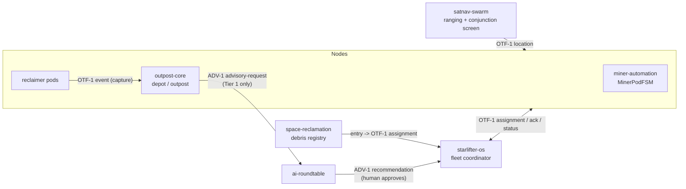

# Fleet Integration

How the system repos fit together, and the contract between them. The
runnable proof is [`integration/run_scenario.py`](../../integration/run_scenario.py).



## One wire format: OTF-1

Every packet between components is [OTF-1](https://github.com/Overby-Industries/telemetry-protocol).
No repo defines a competing format; each one either *produces* OTF-1 or
*consumes* it.

| Repo | Produces | Consumes |
|---|---|---|
| `space-reclamation` | `assignment` (from a registry entry) | `event` (feedstock + ODCI totals) |
| `satnav-swarm` | `location` object (the position half of `status`/`event`) | ranges, ephemeris |
| `outpost-core` | `status`, `ack`, ADV-1 requests | `assignment`, `event` |
| `miner-automation` | `status` (`MinerPodTelemetry.h`) | `assignment` (via `minerPodAckReason`) |
| `ai-roundtable` | ADV-1 recommendation | ADV-1 request |

## Two tiers, never mixed

From `starlifter-os/docs/ai-advisory-layer-draft.md`:

- **Tier 0** — time-critical hazards (imminent conjunction, containment
  failure, emergency docking). Deterministic code, no AI, no human approval
  in the loop. `satnav_swarm.screen_conjunctions` labels close approaches
  `tier0` / `tier1`; `outpost_core` treats priority 10 as Tier 0 and refuses
  to generate an advisory for it.
- **Tier 1** — deliberative decisions (equal-priority contention for a
  docking port, task prioritization). Sent to `ai-roundtable` as an ADV-1
  request. The request **always carries a `defaultChoice`** that applies if
  no human approves a recommendation by `decideBy`, so nothing blocks on the
  roundtable, and a recommendation is schema-locked to
  `requiresHumanApproval: true`.

## Gaps found while integrating

- OTF-1 `nodeType` has no `outpost`; the depot advertises as `refinery`
  (see `outpost-core/docs/otf1-gap.md`).
- OTF-1 `location` has no coordinates, only altitude/inclination/zone, so a
  position fix can be reported coarsely but not fully. Relative formation
  data (satnav-swarm's main output for a swarm) has no OTF-1 home yet.
- The Jac roundtable engine does not yet consume ADV-1 requests; the schemas
  and validator exist so that work has a fixed target.

## Running the scenario

Check out the repos side by side, then:

```
pip install jsonschema
python design-studies/integration/run_scenario.py
```

Needs siblings `outpost-core`, `satnav-swarm`, `space-reclamation`,
`ai-roundtable` and `telemetry-protocol`. Every packet it builds is
validated against the real OTF-1 schema.
