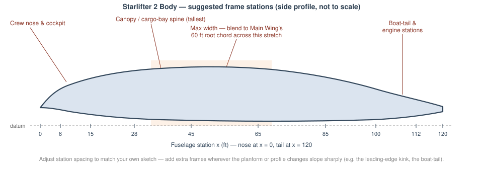
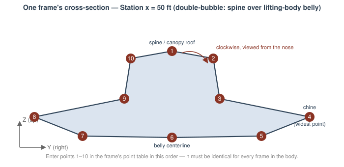

# Designing the Starlifter 2 Body in XFLR5 (Frame-Based Workflow)

For Project Helga / Starlifter 2 (SSTO-44) — a 120 ft lifting-body centerbody blending into your existing Main Wing and Elevator.

---

## 1. How the pieces fit together

Your Plane in XFLR5 is assembled from separate objects, and your screenshots show three of them already in progress:

| Object | What it is | Current data |
|---|---|---|
| **Body** | The lifting-body centerbody — nose, crew pod, canopy/cargo spine, blended belly, boat-tail | 3 frames so far; this guide gets it to 120 ft |
| **Main Wing** | The swept outboard lifting surface | Span 100 ft, root chord 60 ft, taper 0.067, sweep 35.75°, AR 4.17 |
| **Elevator** | Aft pitch-control surface | Present, but see the flag below |

The Body's local x-axis runs nose-to-tail (fuselage stations), independent of the Main Wing's span (its own y-axis, tip-to-tip). At 120 ft your Body is almost exactly Space Shuttle Orbiter length (122 ft) — a genuinely useful real-world reference for proportions, landing gear placement, and the blended lifting-body cross-section.

One thing worth flagging now: your wing/elevator readout shows **Tail Volume = -0.017**. That's both very small and negative, which usually means the elevator's aerodynamic center is sitting at or ahead of the CG rather than well aft of it. A tailless-leaning, lifting-body layout like this one typically needs either real aft moment arm on that surface or reflex/washout built into the wing to hold pitch trim. Worth re-checking the elevator's X position relative to the CG once the body geometry settles — happy to dig into that separately if useful.

---

## 2. Fix this first: Frame_2's position

Your screenshot shows **Frame_2 at x_Position = 306.00 ft** — outside a 120 ft body entirely. Before adding anything else:

1. Select **Frame_1** and **Frame_3** and note their x_Position values.
2. Make sure all frame x-positions fall between 0 and 120 ft, strictly increasing from Frame_1 to the last frame (XFLR5 sorts frames by x, but a wildly out-of-range value like 306 ft will badly distort the lofted surface even so).
3. If Frame_2 was meant to sit mid-body, something in the 20–70 ft range is more likely correct — see the station plan below.

---

## 3. How XFLR5's frame-based Body actually works

XFLR5 gives you two ways to represent a body, and it matters which one you're in:

- **Flat panels** ("Analysis" purpose / BODYTYPE 1) — digitizes an existing shape as-is. Straight-line facets between your points, so the surface passes *exactly* through every control point.
- **NURBS / B-Splines** ("Design" purpose / BODYTYPE 2) — what your tree shows (the `NURBS` node). This is what you want for sculpting a new lifting-body shape from scratch.

**Important caveat, confirmed on the XFLR5 forum:** when the NURBS degree is anything other than 1, the lofted surface does **not** pass exactly through your control points — it's pulled toward them, not through them. For most of the hull this doesn't matter, but if you need an exact 120.00 ft overall length or an exact width at the wing-blend station, either nudge the relevant control points outward slightly to compensate, or add a couple of extra closely-spaced frames near that station to pin the surface down. One forum contributor's blunt advice: if you need dimensional precision and don't want to fight the spline, use flat panels instead and accept a less smooth (but exact) surface.

**Frame rules** (from the official XFLR5 guidelines):

- Every frame must have the **same number of control points** (n). If frames disagree, the *last-defined* frame's count silently wins.
- Frames are automatically sorted by x-position.
- A frame's x-position is taken from its **first point**.
- Points within a frame are entered **clockwise, as viewed from the nose looking aft**.

Two fields in your tree are worth double-checking against this:

- **Lengthwise parameter** (shown as `1` under Frame_2) — this is the frame's normalized position (u = 0 → 1) along the NURBS length direction, separate from its literal x_Position in feet. Frame_1 should read something close to 0 and your last frame close to 1, with interior frames in between, in the same order as their x-positions. A value of `1` on your *second* frame (not your last) is another sign this frame needs attention.
- **Hoop_panels** — almost certainly the circumferential (around-the-cross-section) panel count/type, separate from the `NURBS` node's degree settings. Check both before regenerating.

---

## 4. Recommended frame stations

Based on your sketches (nose/cockpit, canopy spine over the cargo bay, the blended lifting belly, and the four-nozzle boat-tail), here's a starting station plan:



| Station (ft) | Purpose | Notes |
|---|---|---|
| 0 | Nose tip | Collapse all points to a single coincident point here so the surface closes cleanly (this is exactly how the sample fuselage files on the XFLR5 forum handle a nose) |
| 8 | Crew pod | Cross-section grows enough to enclose the 4-seat cockpit arrangement from your top-view sketch |
| 20 | Canopy / cargo-bay spine | Tallest point of the dorsal spine — matches the "Cargo Bay" callout in your side view |
| 35 | Blend zone starts | Body cross-section widening toward its max |
| 50 | **Max width** | Widest station — this is where the body should hand off to the Main Wing's root |
| 70 | Blend zone ends | Body narrowing again as the wing takes over more of the lift |
| 95 | Aft taper | |
| 120 | Boat-tail / engine stations | Where the 4 nozzles sit; if you'll run 3D-panel analysis, close this to a point or a small flat cap the way the nose is closed — an open trailing base triggers the "volume not closed" numerical error the guidelines warn about |

**Why 35–70 ft specifically:** your Main Wing's root chord is 60 ft. If you center that chord in the blend zone, the root leading edge lands around x ≈ 30–35 ft and the root trailing edge around x ≈ 90–95 ft — reasonably close to the stations above. Adjust once you fix the wing's actual X-offset in the Plane assembly, but it's a sane starting point.

Add extra, closely-spaced frames anywhere the *planform* changes slope sharply — most importantly at the leading-edge kink visible in your top-view sketch, and through the boat-tail curvature. NURBS surfaces smooth through whatever frames you give them, so a sharp real crease needs either a tightly-spaced pair of frames or an accepted rounding-over.

---

## 5. Building one frame's cross-section

Each frame is a closed loop of points in the frame's local y-z plane (y = lateral, z = vertical). Your design's "double-bubble" shape — a narrower canopy/spine sitting on top of the wide, flat lifting-body belly — is a natural fit for a 10-point frame:



A full set of placeholder points for all 8 stations above (10 points each, scaled to grow from the nose and taper into the boat-tail) is in the companion file **starlifter2_frame_points.csv**. These are illustrative starting numbers, not your final dimensions — replace them with whatever actually fits your crew pod, cargo bay, and gear bay once those are sized. The station-50 (max-width) row, for reference:

| Point | y (ft) | z (ft) | Feature |
|---|---|---|---|
| 1 | 0.00 | 8.80 | Top of spine/canopy |
| 2 | +4.20 | 8.05 | Upper spine, right |
| 3 | +4.83 | 3.95 | Shoulder — spine meets belly |
| 4 | +14.00 | 2.09 | Chine — widest point |
| 5 | +9.10 | 0.15 | Lower belly, right |
| 6 | 0.00 | 0.00 | Belly centerline (lowest point) |
| 7 | -9.10 | 0.15 | Lower belly, left |
| 8 | -14.00 | 2.09 | Chine, left |
| 9 | -4.83 | 3.95 | Shoulder, left |
| 10 | -4.20 | 8.05 | Upper spine, left |

### Getting points into XFLR5 efficiently

Typing 8 frames × 10 points through the GUI table is slow and error-prone. XFLR5 supports round-tripping a body as a text file, which is much faster for a shape this complex:

1. **Export your current (3-frame) body first** — this gives you the exact template your v6.61 build expects, rather than guessing at the format.
2. Edit that file in a text/spreadsheet editor, using the CSV as your source data.
3. Re-import.

The general structure documented for this format is:

```
Body_Name
...
FRAME
x1 y1 z1
...
xn yn zn

OFFSET
X_o Y_o Z_o

BODYTYPE
1 or 2
```

(Keyword lines are preceded by `#`.) Some XFLR5 project files instead use an XML representation with `<point>` tags per frame — which one your export produces is exactly why step 1 above matters more than this reference snippet.

---

## 6. Blending the Body into the Main Wing and Elevator

This is the part XFLR5's own documentation is candid about being imperfect: *"the body's panels are not adapted to follow \[the wing's] contour... some of the body's panels will be located inside the volume."* In practice:

- XFLR5 auto-trims the wing/elevator/fin to the body's surface, but does **not** reshape the body's panels to match the cut. Expect some manual iteration at the junction.
- Tip patches are auto-generated at wingtips and fin tips, but **not** at the wing-body junction — that seam is on you.
- Keeping a frame exactly at (or just inside) the wing's root leading and trailing edge x-stations gives the trimming algorithm a clean edge to work with, rather than asking it to cut through the middle of a smoothly interpolated NURBS span.

---

## 7. Mesh, regenerate, and view controls

Matching the controls visible in your Body Object Explorer:

- **Actions** dropdown — import/export body definition, scaling, and other bulk operations live here.
- **Regenerate (F4)** — re-lofts the NURBS surface from your current frames; use this after every batch of point edits rather than trusting a stale preview.
- **Surfaces / Panels / Outline / Axes / Masses** checkboxes — turn on **Panels** once you're meshing, so you can see panel aspect ratio directly. The guidelines recommend keeping chordwise/hoop panel aspect ratios low and using cosine-type spacing for panel density near high-curvature regions (nose, canopy shoulders, boat-tail) — the same logic as wing meshing.
- The small orientation icons (front/side/top/iso, "180°" flip) and **Reset scale** are your fastest way to sanity-check a frame right after editing it — flip between views rather than only trusting the 3D perspective pane.
- **Save** commits; **Discard** throws away unsaved edits — cheap to use liberally while you're iterating on frame shapes.

---

## 8. What XFLR5 can (and can't) tell you about this vehicle

Worth being direct about this: XFLR5's solvers (Lifting Line Theory, Vortex Lattice Method, 3D panel method, and XFoil's 2D viscous polars) are all **subsonic, incompressible potential-flow methods**. They have nothing to say about scramjet propulsion, plasma effects, compressibility, shock waves, or the hypersonic/orbital regime this vehicle is actually designed to operate in. Nothing in this guide — or in XFLR5 generally — validates the ascent or reentry phase.

Where it's genuinely useful for a design like this:

- **Lofting the outer mold line** — everything above — so you have a real, checkable 3D shape and can extract mass/inertia estimates, wetted area, and volume.
- **Low-speed, unpowered glide and landing characteristics** — CG position, static margin, and trim through the VLM/panel solvers, the same regime the real lifting-body program (X-24A/B, HL-10, M2-F3) and the Shuttle Orbiter actually flew and validated by gliding to a landing. This is a legitimate and well-precedented use of a low-speed aero tool on a hypersonic vehicle's shape.

For shape inspiration beyond XFLR5's reach — the blunt nose and leading-edge radii on those same real lifting bodies exist specifically to detach the bow shock and manage reentry heating (heat flux at a stagnation point scales with the inverse square root of nose radius). Your sketch's rounded nose cone is already pointed in the right direction for that reason, even though XFLR5 itself won't model the thermal side of it.

---

## Files in this package

- `XFLR5_Starlifter2_Body_Guide.md` — this guide
- `frame-station-map.svg` — side-profile station diagram (Section 4)
- `frame-cross-section.svg` — single-frame point-ordering diagram (Section 5)
- `starlifter2_frame_points.csv` — placeholder (y, z) points for all 8 stations × 10 points, ready to adapt into your export/import text file

## Quick checklist

- [ ] Correct Frame_2's x_Position (currently 306 ft — needs to be inside 0–120 ft)
- [ ] Confirm Frame_1 / Frame_3 x-positions and the "Lengthwise parameter" ordering
- [ ] Decide flat-panel vs NURBS body type based on whether exact dimensions or surface smoothness matters more
- [ ] Add frames at the 8 stations above (or your own), keeping point-count identical across all frames
- [ ] Export → edit in bulk → re-import rather than hand-typing every point
- [ ] Regenerate (F4) after each batch of edits and check Panels view for aspect ratio
- [ ] Iterate the wing/elevator junction manually — XFLR5 won't do it for you
- [ ] Re-check Elevator position once the body is stable — Tail Volume is currently -0.017
