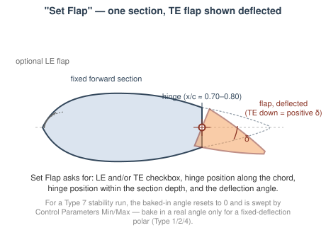
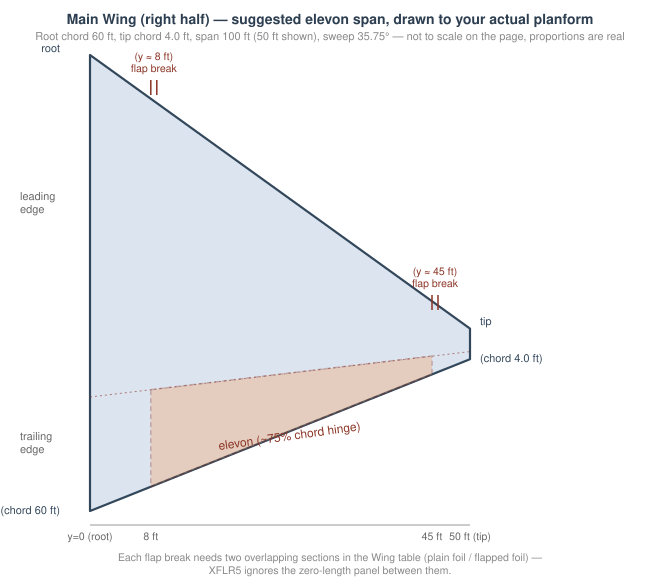

# Adding Flaps and Control Surfaces to the Starlifter 2 Main Wing (XFLR5)

Companion to the body guide — this one covers flaps, elevons, and other control surfaces on your Main Wing (span 100 ft, root chord 60 ft, taper 0.067, sweep 35.75°), and how to actually get control derivatives out of XFLR5 v6.61 for them.

---

## 1. The model behind XFLR5's flaps (read this before touching the GUI)

A flap in XFLR5 is not a property of the wing panel — it's baked into the **foil**, and the wing panel just changes shape where a flapped foil replaces a plain one. Two consequences that aren't obvious from the GUI:

- A flap's spanwise boundary is created by placing **two overlapping sections** at (nearly) the same span position in the Wing table — one using the plain foil, one using the flapped foil. XFLR5 treats the panel between them as zero-length and ignores it; the "break" is what defines where the flap starts or stops.
- Triangular flaps (plain foil at one end of a panel, flapped foil at the other, with real span between them) are **not recognized** — you always need the paired same-position sections.

The official guidelines are also direct about a related trap: a wing can technically be made **asymmetric** (different foils left vs. right) to fake a static aileron deflection, but this "has been tested neither against experimental nor theoretical results" — treat it as unvalidated. The supported path for anything you want real numbers from is the stability/control-derivative workflow in Section 4, not a permanently-lopsided wing.

---

## 2. Creating a flapped foil — the "Set Flap" workflow

1. In the foil list (Direct Foil Design, or wherever your Main Wing's foil lives), **right-click the foil → Set Flap**.
2. Check the box for a **leading-edge (LE)** and/or **trailing-edge (TE)** flap — you can define both on the same foil (useful if you want a droop LE plus a TE elevon on the same section).
3. Enter the flap's characteristics: **deflection angle**, **hinge position along the chord** (x/c), and **hinge position within the section's depth**.
4. Click OK, then name the new derived foil (or **Overwrite** the original if you don't want a separate copy).
5. Repeat for every distinct foil in your wing that needs a control surface.

**One angle-related gotcha that will save you a debugging session:** the angle you bake in here only matters for a *fixed-deflection* analysis (a normal Type 1/2/4 polar run with that geometry). If you're instead running a **Type 7 stability analysis** to get control derivatives (Section 4), XFLR5 resets the baked-in angle to zero and drives the deflection from the analysis's own Control Parameters instead. So: for a "what does 20° of elevon look like at cruise" polar, bake in 20°. For "what's my roll control derivative," bake in 0° — the hinge just needs to exist.

Hinge position: a common real-world starting point (used in at least one published BWB/lifting-body thesis that also used XFLR5 for its stability work) is a hinge around **75–80% chord**. That's a reasonable default for elevons here too, adjusted per section since your wing's chord shrinks a lot toward the tip.

---

## 3. Placing the flap break in the Wing table

For each control surface, insert **two rows** in the Wing definition table at (nearly) the same spanwise y — the inboard one carrying the plain foil, the outboard one carrying the flapped foil, or vice versa depending on which direction the surface extends. Practical notes carried over from general XFLR5 wing meshing (same logic as the panel-density guidance in the body guide):

- Give the overlapping (zero-length) transition section **1 panel division** — there's no real span there, so more panels just waste mesh.
- Use **Cosine** spanwise distribution elsewhere so panel density increases toward the root/tip and toward any flap break, matching the guidelines' general advice to increase mesh density at geometric breakpoints.
- Every wing panel should keep the **same number of chordwise panels** across the span for the doublet-gradient math (3D panel method) to behave — don't let the flap panels use a different chordwise count than their neighbors.
- The guidelines describe a specific "false flap set at 0° flap angle" trick for keeping mesh panels connected across a break — if you see connectivity artifacts at a flap boundary, that's the fix: give the "plain" side of the break a flap-enabled foil too, just deflected to exactly 0°, rather than a foil with no flap defined at all.

---

## 4. A concrete layout for your wing

Given the taper (root 60 ft → tip ~4 ft) and 35.75° sweep, a full-span elevon runs out of usable chord fast near the tip. A reasonable starting span band:

| Span station | Local chord | Hinge x (≈75% chord) | Note |
|---|---|---|---|
| y = 0 (root) | 60.0 ft | 45.0 ft aft of root LE | inboard of the elevon — keep clean for the body blend |
| y = 8 ft | 51.0 ft | — | **flap break** (inner end of elevon) |
| y = 45 ft | 9.6 ft | — | **flap break** (outer end of elevon) |
| y = 50 ft (tip) | 4.0 ft | 3.0 ft aft of tip LE | outboard of the elevon — too little chord for a useful hinge |

That leaves the inner 8 ft clean for the body-blend region (Section 5 of the body guide) and the outer 5 ft as a fixed tip, which is typical practice for a highly tapered planform where tip chord gets structurally thin.

### Which control architecture?

Your project currently has both a **Main Wing** (candidate for elevons) and a separate **Elevator** object. Worth deciding deliberately rather than by default, since it changes how you set up Section 4's analyses:

- **Tailless-leaning**: elevons on the Main Wing do both pitch and roll; the Elevator becomes a secondary trim surface or gets removed. Fits the lifting-body look of your sketches better, but pitch authority depends entirely on elevon moment arm and any reflex/washout in the wing itself.
- **Conventional-leaning**: keep the Elevator as primary pitch control, use Main Wing flaps purely as ailerons (differential only, no symmetric/pitch function). Simpler control derivatives to separate, but only works if the Elevator's moment arm is real — which is exactly what the -0.017 Tail Volume flagged in the body guide calls into question.

Either way, a rudder needs a **Fin** object, which isn't in your project yet as far as these screenshots show — worth adding before you need yaw control derivatives.

---

## 5. Getting control derivatives: Type 7 stability polars

XFLR5 v6 **removed the old Type 5/6 control polars** — they're replaced entirely by **Type 7 stability polars**. This is the only route to quantified control derivatives in your version, via **Analysis → Define a Stability Analysis**.

**Prerequisites** (confirmed from both the official guidelines and independent tutorial documentation):

- Airfoil polars already analyzed for every foil involved (XFoil Direct Analysis)
- A basic wing/plane polar already run successfully
- Cm–α curve has a positive x-intercept
- Cm–CL curve has a positive CL at Cm = 0
- Plane inertia tensor and CG are correct (or defined manually in the Mass/Inertia tab)
- Control surface geometry and paneling are actually right at the breaks (Section 3)

The last two static-stability preconditions are exactly why the Tail Volume flag from the body guide matters — if the plane isn't statically stable in pitch yet, the stability analysis either won't converge or won't mean much even if it runs.

**Control Parameters tab — the two things everyone gets wrong first:**

1. **Run one control group per analysis.** Don't try to activate ailerons, elevator, and rudder together in a single Type 7 run — activate only the group you're isolating (e.g., ailerons only) to get that group's derivatives cleanly, then run it again with only the elevator active, and again for the rudder. This is both the documented recommendation and a workaround for a known rough edge where mixing groups (especially elevon-style combined surfaces) can silently return no results.
2. **Set opposite Min/Max for ailerons, matching Min/Max for elevators.** Sign convention (right-hand rule): a positive wing/elevator flap rotation moves the trailing edge **down**; a positive rudder rotation moves the trailing edge to **starboard**. For differential aileron/elevon roll, give the left and right control the opposite sign range (e.g., -10° to +10° on one side, +10° to -10° on the other) so they actually move apart rather than together. The control variable sweeps as `(1-c)×Min + c×Max`, so mismatched signs are how you get differential motion out of one "c" parameter.

**One tab that's easy to miss — Extra Drag.** XFLR5's solvers only compute airflow over lifting surfaces (wings, elevator, fin — and body panels only if you're running the 3D panel method with the body included). Landing gear, antennas, and any non-lifting protrusions don't contribute drag automatically; add an estimated area and Cd for them in the Extra Drag tab, the same way you'd hand-add the nozzle fairings or gear doors from your sketches. Worth double-checking that whichever analysis type you're running actually includes your Body's panels — if you're on LLT or VLM (wing-only methods), the body isn't contributing lift or drag at all regardless of this tab.

---

## 6. What this validates for an SSTO, and what it doesn't

Same caveat as the body guide, worth repeating here specifically: every derivative Section 5 produces is from a **subsonic, incompressible panel/vortex method**. It tells you nothing about elevon hinge moments at hypersonic AoA, shock-boundary-layer interaction on a control surface, or how authority changes through the transonic regime on reentry. What it *is* legitimately good for — and this is a real, historically-used technique, not a stretch — is control power for the **unpowered subsonic glide and landing phase**, the same regime the Shuttle Orbiter's body flap and elevons, and the X-24/HL-10 lifting bodies, were actually flight-tested in. If Starlifter 2 needs to flare and land like its real-world analogs, this is exactly the flight regime XFLR5's Type 7 analysis can speak to.

---

## Files in this package

- `XFLR5_Starlifter2_ControlSurfaces_Guide.md` — this guide
- `flap-hinge-section.svg` — Set Flap hinge/deflection diagram (Section 2)
- `elevon-layout.svg` — elevon span drawn on your actual wing planform (Section 4)

## Quick checklist

- [ ] Set Flap on each foil that needs a control surface (LE and/or TE, hinge %, hinge depth)
- [ ] Bake in a real deflection angle only if you want a fixed-deflection polar; leave 0° if you're headed for Type 7
- [ ] Add paired overlapping sections in the Wing table at every flap break; overlap section = 1 panel
- [ ] Decide elevon-primary vs. separate-elevator architecture before setting up Section 5's analyses
- [ ] Add a Fin object before you need rudder derivatives
- [ ] Run Type 7 stability analyses one control group at a time; opposite Min/Max for ailerons
- [ ] Confirm Cm–α and Cm–CL preconditions pass before trusting any control derivative output
- [ ] Fill in the Extra Drag tab for gear/antennas/nozzle fairings; verify your analysis type actually includes the Body's panels
