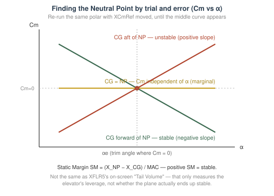
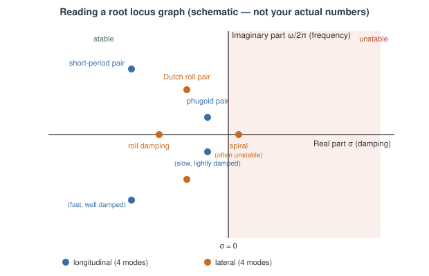

# Reading XFLR5's Output — Starlifter 2

What the numbers and graphs actually mean, walked through using the readout that's already on your own screen.

---

## 1. The panel you're already looking at

Every one of your renders carries this block. Here's what each line actually is:

| Field | Your value | What it means |
|---|---|---|
| Wing Span | 100.000 ft | True span, tip to tip, along the wing surface |
| xyProj. Span | 79.970 ft | Span **projected onto the horizontal plane** — smaller than true span because of dihedral/geometry out of plane. The gap between these two numbers is a quick sanity read on how much your wing deviates from flat |
| Wing Area / xyProj. Area | 222.967 / 222.912 m² | Same idea — true surface area vs. its flat projection. Barely different here, so dihedral effects are small |
| Plane Mass | 79000.000 lb | Total mass fed into the Plane's inertia — changed from your earlier 97,000 lb, so double check this reflects a real design update and not a leftover default |
| Wing Load | 354.400 lb/m² | Mass ÷ Wing Area — recalculates automatically when mass changes, which is why it moved with the mass edit |
| **Tail Volume** | **-0.017** | Elevator leverage: (elevator lever arm × elevator area) ÷ (MAC × wing area). Still flagged — see Section 3, this number alone doesn't prove or disprove stability, it only measures how much leverage the elevator *has available* |
| Root Chord | 60.000 ft | Main Wing chord at the centerline |
| MAC | 38.444 ft | Mean Aerodynamic Chord — the reference length used to non-dimensionalize moment coefficients (Cm) and to compute static margin |
| TipTwist | 0.000° | No washout currently built into the tip — relevant if you go the tailless/washout route from the control-surfaces guide |
| Aspect Ratio | 4.167 | Span²/Area — a low-AR number, part of why LLT was ruled out in the testing guide |
| Taper Ratio | 0.067 | Tip chord ÷ root chord — very pointed planform |
| Root-Tip Sweep | 35.754° | Leading-edge sweep |

None of this block is a *result* of an analysis — it's a description of the geometry. The actual aerodynamic answers live in the polar graphs and operating points covered below.

---

## 2. Three points that get confused constantly

XFLR5's own stability documentation calls this out directly because mixing these up is the single most common source of misreading results:

- **Centre of Gravity (CG / XCmRef)** — where moments are calculated about. Depends only on mass distribution, nothing aerodynamic.
- **Neutral Point (NP)** — the reference position where the pitching moment stops depending on angle of attack. Depends only on external geometry, not mass.
- **Centre of Pressure (CP)** — where the net aerodynamic force actually acts. Depends on both geometry and the current angle of attack, so it moves as α changes.

The wind-vane analogy: CG forward of the NP is a vane that weathercocks back into the wind (stable). CG exactly at the NP spins indefinitely (marginal). CG aft of the NP is stable **in the wrong direction** — it diverges. The Neutral Point is the rear limit for where the CG is allowed to sit.

---

## 3. The Tail Volume / Static Margin trap

This is worth being precise about, because XFLR5's own history has a documented mislabeling here. Up to v3.12, a field literally called "Static Margin" in the software was actually computing **(X_CP − X_CG)/MAC** — not the real static margin. The real one is:

**SM = (X_NP − X_CG) / MAC** — positive means stable, and the bigger it is, the more stable (and less maneuverable) the plane is.

Tail Volume, separately, is only a measure of how much leverage the elevator *could* apply — it says nothing about the sign or magnitude of the actual pitching moments, so an "adequate" tail volume is a **necessary, not sufficient**, condition for stability.

**How to actually find your Neutral Point and Static Margin:**

1. Run a Type 1 (or Plane) analysis and plot Cm vs. α.
2. Note the slope. Negative slope = CG is currently forward of NP (stable). Positive = aft (unstable). Flat/zero = CG is sitting exactly at the NP.
3. Move XCmRef (the moment reference / CG position) and re-run. Repeat until the curve goes flat.
4. Whatever X you used for that flat run **is** your Neutral Point.
5. Static Margin = (X_NP − your actual CG) / MAC.

Do this before trusting the -0.017 Tail Volume number as the whole story — it's entirely possible to have a mediocre tail volume and still land in a stable CG range, or a fine-looking tail volume and still be unstable, depending on where the CG and NP actually fall.

---

## 4. Reading a basic polar: finding your trim point

A standard Type 1 run gives you (at minimum) four curves vs. α. Read them together, not separately:

1. **Cm vs. α** — find where Cm = 0. That angle is your trim/balance angle, αe.
2. **Cl vs. α** — read the Cl at αe. It needs to be **positive** — a balance point at negative Cl means the plane balances upside-down relative to how it needs to fly.
3. **Cl/Cd vs. α** — read the L/D at αe. There's no guarantee this lands anywhere near the L/D peak; trim and best-glide angle are two different α's unless you specifically design them to coincide.
4. **XCP vs. α** — at αe, XCP should equal XCmRef (your CG position). This is a consistency check on the same trim point from a different angle.

If Cl at your trim angle comes out negative, that's the self-stability problem the control-surfaces guide referenced: either your wing's airfoil needs a positive zero-moment lift (reflex camber, Cm0 > 0), or you need washout (negative twist) at the tip so the tip generates a small negative lift that balances the root's pitching moment — which is exactly the "self-stable flying wing" mechanism, as distinct from just picking a self-stable-labeled airfoil.

---

## 5. Reading the stability analysis output (Type 7)

One Type 7 run gives you three separate things: the plane's **natural modes** (how it responds on its own preferred frequencies), its **open-loop response** to a disturbance like a gust, and its **forced response** to a control input like a rudder or elevator step.

### The 8 natural modes

A well-behaved plane has 4 longitudinal and 4 lateral natural modes:

| Mode | Character | What's physically happening |
|---|---|---|
| **Phugoid** (×2, longitudinal) | Slow, often lightly damped | A slow trade of kinetic and potential energy — the plane dives, gains speed, climbs, loses speed, repeats. Constant angle of attack throughout; it's a speed/altitude oscillation, not a pitch oscillation |
| **Short period** (×2, longitudinal) | Fast, usually well damped | Quick pitch/vertical motion, governed mostly by how stiff the Cm-vs-α slope is |
| **Dutch roll** (×2, lateral) | Yaw and roll coupled 90° out of phase, often lightly damped | Sideslip creates asymmetric lift and drag, which couples rolling into yawing and back |
| **Roll damping** (lateral) | Fast, stable, non-oscillatory | The wing dropping increases its local AoA and lift, creating a restoring moment — this is usually the best-behaved mode on the aircraft |
| **Spiral** (lateral) | Very slow, non-oscillatory, **often unstable** | A bank/heading disturbance feeds back through the fin into a yawing moment that reinforces the bank — needs pilot (or autopilot) correction to keep from slowly diverging |

Each eigenvalue is a complex number λ = σ + iω. **σ (the real part) is the damping constant** — negative means the mode decays and is stable, and more negative means more heavily damped; positive means it grows and is unstable. **ω/2π (the imaginary part) is the frequency** — modes on the real axis (ω = 0, like spiral and roll damping) don't oscillate at all, they just grow or decay.

A rough sanity check on relative scale: for a small sailplane, published XFLR5 comparisons show the phugoid running around 0.1–0.15 Hz (7–8 second period) against a short-period mode closer to 4 Hz (roughly a quarter-second period) — a factor of 30-40x apart. Starlifter 2 is a much larger, heavier vehicle, so don't expect those absolute numbers, but the *qualitative* pattern — phugoid slow, short period fast, cleanly separated in frequency — is what "well-behaved" looks like on the root locus. Modes that aren't well separated tend to couple and are harder to interpret cleanly.

**Reading the eigenvector itself:** XFLR5 doesn't give you a clean equation for what a mode "looks like" — the intended way to understand a mode's shape is the 3D animation view. The animation's amplitude has no physical meaning (it's just scaled to be visible), and remember that a real disturbance excites some combination of all 8 modes at once, never just one in isolation.

### Control derivatives

These come from the same Type 7 run, restricted to one control group at a time (per the control-surfaces guide). Both dimensional and non-dimensional versions are reported — the non-dimensional ones are what you want for comparing across different flight conditions or against textbook values.

---

## 6. What the data can't tell you

Same honest boundary as the other guides: everything above is subsonic, incompressible potential flow. It's a genuinely good read on trim, static stability, and dynamic modes for the unpowered glide-and-land phase — not on anything happening during scramjet ascent or reentry.

---

## Files in this package

- `XFLR5_Starlifter2_Reading_Data_Guide.md` — this guide
- `neutral-point-finder.svg` — Cm-α diagram for locating the Neutral Point (Section 3)
- `root-locus-map.svg` — schematic eigenvalue map for the 8 natural modes (Section 5)

## Quick checklist

- [ ] Read Wing Span vs. xyProj. Span as a quick check on how far the geometry deviates from flat
- [ ] Don't confuse CG, Neutral Point, and Center of Pressure — they answer different questions
- [ ] Find the real Neutral Point by moving XCmRef until Cm-α goes flat, don't rely on Tail Volume alone
- [ ] Confirm Cl is positive at your trim angle (Cm = 0), not just that a trim angle exists
- [ ] Cross-check XCP = XCmRef at trim as a second read on the same balance point
- [ ] On a Type 7 run, read σ (real part) for stability/damping and ω/2π (imaginary part) for frequency on every mode
- [ ] Use the 3D mode animation to identify which eigenvalue is which mode, rather than guessing from magnitude alone
- [ ] Keep control-derivative results scoped to whichever single control group was active in that run
